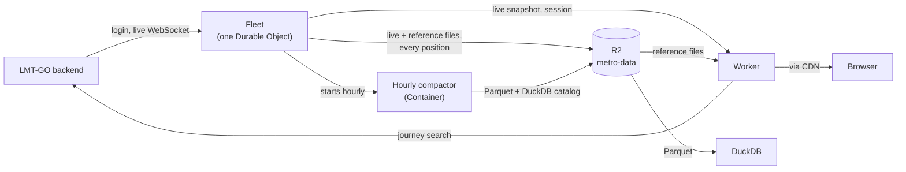

# Metro Colombo

Find your next Lanka Metro bus around Colombo, and watch it come to you.

**[Open the app](https://metro.manasa.ai)** · [API docs](https://metro.manasa.ai/docs) · [Fleet data](https://metro.manasa.ai/data) · [`llm.txt`](https://metro.manasa.ai/llm.txt)

A free, open-source trip planner and live bus map for Lanka Metro Transit
(LMT-GO / SmartMetro). No account, no NIC, no app store. Open the link and
plan your trip.

Not affiliated with Lanka Metro Transit, Smart Metro or the official LMT GO
app. For trip planning only, not tickets or official service information.

## Why this exists

I wanted my mom to take the Metro bus that starts at the junction near our
place instead of standing and sweating on a private bus. She can find her way
around her phone, but she found the official LMT-GO app difficult and
unintuitive. A couple of foreign friends living in Sri Lanka couldn't use it
at all, because it asks for an NIC and personal details before it shows you
where a bus is.

So I reverse engineered the app and built this: the same routes, timetables
and live positions, in a web page anyone can open without signing up.

## What it does

- **Plan a trip.** Pick where you are (or let it find the nearest stop) and
  where you're going. It tells you which bus to take, where to change, where to
  get off, what it costs and when it leaves. Recent trips are one tap away.
- **See the buses live.** Every bus on the road, on the map, moving along its
  route, refreshed every 5 seconds.
- **Follow your bus.** Tap any bus to see the stop it's at, the next stop and
  how many stops until yours, like the indicator inside the bus. A shared link
  opens the same view on someone else's phone.
- **Know when it's packed.** Buses bounce on the map as they fill up. The
  fuller the bus, the harder it bounces.
- **Driver view.** A third-person camera that chases the bus you're following.
  There is no good reason for this. It's fun.
- **Browse routes.** Each route's stops in order, both directions, and the
  buses on it right now.
- **Your language.** English, Sinhala and Tamil, plus Hindi, Russian, Chinese,
  Japanese, German, French and (as a joke) Latin. Stop search works in English,
  Sinhala and Tamil.
- **Festive touches.** On Sri Lankan holidays the map dresses up, from Vesak
  lanterns to Christmas trees. You can turn them off.

It works on any phone with a browser and can be added to your home screen.

## For developers and data people

Everything the app shows is open to you too, free and without a key.

**The API.** Routes, stops, route shapes, journey plans, fares and live bus
positions as JSON with open CORS. See [`/docs`](https://metro.manasa.ai/docs),
or [`/llm.txt`](https://metro.manasa.ai/llm.txt) if you're pointing an AI at
it. There are no payment or ticketing endpoints and there never will be.

```bash
curl https://metro.manasa.ai/api/routes
curl 'https://metro.manasa.ai/api/journey?from=MMC-1&to=MCC5'
curl https://metro.manasa.ai/api/live
```

**GTFS (partial).** A static GTFS zip with `agency`, `routes`, `stops` and
`shapes` is listed under `gtfs/static` in
[the reference manifest](https://data.metro.manasa.ai/reference/manifest.json),
and GTFS-Realtime vehicle positions are at
`https://data.metro.manasa.ai/live/vehicles.pb`. There are no trips, stop
times or calendar yet, so trip planners that need a complete feed can't use
it; it's enough to draw the network and the buses on it.

**The fleet archive.** Every bus position since 12 October 2026 is recorded
and published as Parquet with a DuckDB catalog on top. Query it from your
laptop or straight from the browser on the [Data page](https://metro.manasa.ai/data):

```sql
ATTACH 'https://metro.manasa.ai/' AS metro;
SELECT route_code, count(DISTINCT bus_id) FROM metro.fixes_today GROUP BY ALL;
```

Bus bunching, real gaps between buses at a stop, which routes run late: it's
all in there. See [Fleet archive](#fleet-archive) for how it's built.

## How it works



- **One login, shared by everyone.** The operator's API needs a signed-in
  account. A single **Fleet** Durable Object holds that session, the live GPS
  WebSocket and the archive recorder, so visitors never log in.
- **Publish, don't serve.** Live positions and reference data (routes, stops,
  shapes, GTFS) are written to R2 as files and served through the CDN. Only
  journey search runs per request. Readers cost almost nothing and never touch
  the upstream.
- **Runs anywhere.** The domain lives in plain Effect-TS packages with no
  Cloudflare or Node imports. `apps/cloudflare` wires them to Workers, Durable
  Objects and R2; `apps/node` wires the same packages to one Node process and
  any S3-compatible bucket.

Cost and lock-in: production runs on Workers Paid ($5 a month), within its
included usage apart from roughly $1 a month of Container time for the
compactor. Durable Objects, R2, the Cache API and Workers Assets are
Cloudflare-specific; `apps/node` is the way out.

## Run it locally

Requires Node.js **22.19+**. `apps/node` runs the whole site in one process,
from the same packages the production Worker uses.

```bash
npm install && npm --prefix web install
npm --prefix web run build             # the server also serves the built UI
cp apps/node/.env.example apps/node/.env
npm --workspace @metro/node run replay:prepare -- --date 2026-10-12 --out .fleet-data
npm start                              # -> http://127.0.0.1:8789
```

The example config replays a real recorded day of buses and reads routes and
journeys from metro.manasa.ai, so you don't need an LMT-GO account. Routes
answer a few seconds after start, once the first reference publish lands.

`npm run dev` restarts the server on changes. For UI work, run
`npm --prefix web run dev` (http://localhost:5173) next to it; Vite forwards
`/api/*` to port 8789. Add `-- --host` to try it on a phone on the same
network.

### With your own login

Set `LIVE_FEED=lankametro` and `UPSTREAM=lankametro` in `apps/node/.env`, plus
`METRO_PHONE` and `OTP_SECRET` for an LMT-GO account of your own (register it
in the official app). On start the server texts a login code to that phone;
see [Logging in](#logging-in). Don't use the same account as another running
server: a new login can end its session.

### Docker

The `Dockerfile` builds `apps/node` and the UI into one image:

```bash
docker build -t metro .
docker run -p 8789:8789 --env-file apps/node/.env -v metro-state:/data metro
```

The `/data` volume keeps the Fleet's session and, without an S3 bucket, the
published files and the archive.

### On Cloudflare

See [`apps/cloudflare/README.md`](apps/cloudflare/README.md) for the Worker,
its secrets, staging and the compactor container.

## Contributing

Issues and pull requests are welcome, from bug reports to translations.

- Read [`AGENTS.md`](AGENTS.md) for the house rules (it doubles as the guide
  for AI coding agents). The short version: no needless comments, all
  user-facing text goes through Lingui, pure logic goes in `web/src/lib/` with
  tests, and respect `prefers-reduced-motion`.
- Run the checks below before sending a pull request.
- Translators: see [Translations](#translations). Sinhala and Tamil fixes are
  especially welcome.

### Checks

```bash
npm run typecheck                  # packages and the Node app
npm test                           # package and Node app tests (node:test)
npm --prefix web test              # frontend tests (Vitest)
(cd web && npx tsc --noEmit)       # frontend types
npm --prefix web run build         # production bundle
npm --prefix web run format:check  # Prettier, with Tailwind class ordering
(cd apps/cloudflare && npx vitest run)  # Worker tests
```

### Translations

Interface text uses [Lingui](https://lingui.dev). Write English in the code
with the `t` or `<Trans>` macros; the English text is also the message's key.
After adding or changing any English text, update the catalogs:

```bash
npm --prefix web run i18n:extract  # syncs web/src/locales/*/messages.po
```

Translate each new entry in every catalog under `web/src/locales/`, one per
language (any gettext editor works). Keep every `{placeholder}` and
`<0>tag</0>`; the order may change to suit the language. Plurals use ICU
syntax, e.g. `{count, plural, one {# stop} other {# stops}}`.

The production build fails if a catalog entry is untranslated, and the
frontend tests fail if a translation drops or renames a placeholder. Neither
notices English text that hasn't been extracted yet, so run `i18n:extract`
before building. Stop and place names come translated from the API, not from
the catalogs.

## Project layout

```
packages/
  core/              domain: schemas, params, GTFS, archive rows, ports (no runtime imports)
  upstream/          LMT-GO clients: login, live feed, reference reads, replay, proxy
  fleet/             the Fleet: session, live snapshot, recorder, alerts
  publisher/         writes reference files and GTFS to the object store
  api/               HTTP routes: reference, journey, live, status, catalog
apps/
  cloudflare/        Worker, Fleet Durable Object, compactor container (production)
  node/              the same packages in one Node process (npm start), with replay and a compat diff
tests/               checks across packages: the archive contract and runtime boundaries
ops/archive/         hourly compactor: daily Parquet and the DuckDB catalog
web/                 React + Vite UI (TanStack Router/Query, MapLibre, three.js, Tailwind CSS v4, Lingui)
  src/components/    panels, journey results, stop picker, map, bus card
  src/state/         transit data, trip, live buses, selection, routes, map layers
  src/lib/           pure logic, unit tested
  src/occasions/     festive themes and stop decorations
  src/locales/       translation catalogs
  tests/             frontend tests
```

## Reference

### API

All endpoints are `GET`, return JSON, allow public CORS and live under `/api`.
Stop references accept a `stop_code` (e.g. `MMC-1`) or a stop UUID. Errors are
`{"error": "…"}` with status 400 (bad request), 404 (unknown route or path) or
502 (upstream unavailable).

| Path                           | Cache (fresh → stale) | Description                                                                     |
| ------------------------------ | --------------------- | ------------------------------------------------------------------------------- |
| `/api/health`                  | none                  | liveness and upstream reachability                                              |
| `/api/routes`                  | 12 h → 7 d            | all routes (code, English name, colour, directions)                             |
| `/api/routes/:code`            | 12 h → 7 d            | one route, e.g. `/api/routes/CM01`                                              |
| `/api/routes/:code/stops`      | 12 h → 7 d            | stops; `?direction=forward\|reverse\|0\|1\|<direction_id>`                      |
| `/api/routes/:code/geometry`   | 24 h → 30 d           | GeoJSON path; same `direction` values, defaults to the first                    |
| `/api/journey?from=&to=&date=` | 60 s → 10 min         | journey options; `date` is optional `YYYY-MM-DD` (default today)                |
| `/api/live`                    | live snapshot         | latest bus positions, and `age_ms` since the last update                        |
| `/api/places`                  | 24 h → 7 d            | landmarks with their nearest stop (`stop_code`, `stop_id`) and walking distance |

Upstream data is served stale when a refresh fails, so the API keeps answering
through an upstream outage.

**Live positions.** The Fleet keeps one WebSocket open to the operator's GPS
feed (the source the official tracker uses), which sends the whole fleet about
every 5 s; a bus silent for 60 s is dropped. `success` reports whether the feed
is connected, so an empty list from a connected feed means no bus is
reporting, not an outage. `age_ms` is how long ago the current positions
arrived: polling `5000 − age_ms` later picks up the next update as it lands,
which is what the UI does. Positions are corrected for a known upstream fault
that offsets some fixes by one degree, and carry `route_code`. When the Fleet
can't refresh the positions, `stale` is `true` and `reason` says why
(`login_needed` or `feed_down`); `buses` then holds the last known positions.
`/api/health` repeats `reason` under `live`.

#### Example journey response

```jsonc
{
  "from_stop": {
    "id": "4351f529-…",
    "stop_code": "MMC-1",
    "stop_name_en": "Makumbura",
    "latitude": 6.840692,
    "longitude": 79.975769,
  },
  "to_stop": {
    "id": "6d168504-…",
    "stop_code": "MCC5",
    "stop_name_en": "Pannipitiya",
    "latitude": 6.84614,
    "longitude": 79.94917,
  },
  "date": "2026-10-07",
  "options": [
    {
      "departure_time": "2026-10-07T10:30:00+05:30",
      "arrival_time": "2026-10-07T10:40:00+05:30",
      "total_minutes": 10,
      "rides": 1,
      "transfers": 0,
      "total_fare": {
        "full_amount": 85,
        "half_amount": 85,
        "complete": true,
        "category_assumed": false,
      },
      "legs": [
        {
          "kind": "ride",
          "ride": {
            "route": {
              "id": "…",
              "code": "CM03",
              "name": "Makumbura - Kadawatha",
            },
            "bus": { "id": "…", "registration_number": "WP-NE-6503" },
            "board": { "stop_code": "MMC-1", "stop_name_en": "Makumbura" },
            "alight": { "stop_code": "MCC5", "stop_name_en": "Pannipitiya" },
          },
        },
      ],
    },
  ],
}
```

Responses carry more upstream fields than shown (for example `leave_at`,
`time_basis`, per-ride `fare` and every intermediate stop with scheduled and
live times). Journey payloads are passed through from the operator and may
gain fields.

### Data model

- **Routes** (CM01–CM06, CM08) each have two directions, each with its own
  ordered stop list and GeoJSON path.
- **Stops** carry `stop_code`, trilingual names (`stop_name_en` / `_si` /
  `_tm`), `sequence_number` and coordinates. The same physical stop has a
  separate id and code for each direction.
- **Live buses** report `id`, `lat`, `lng` and, when known, route, direction,
  registration, heading and occupancy.
- **Fares** are stop-pair based and come with each journey option
  (`full_amount` / `half_amount`, LKR).
- **Journey options** list `ride` legs (route, direction, assigned bus,
  board/alight stops) and `move` legs for the walk between transfer stops.
  The assigned bus covers a whole day of departures, so it may be live on an
  earlier run.

### Fleet archive

Every live position is recorded into gzipped five-minute chunks on R2, plus a
rolling `today/live.ndjson.gz`, and never read back by the server. An hourly
compactor (`ops/archive/`, Python and DuckDB, run in a Cloudflare Container)
turns finished days into zstd Parquet, writes today's earlier hours to one
file, and publishes a small DuckDB catalog of views over all of it. Readers
fetch Parquet straight from R2's public domain.

To run your own with `apps/node`, point it at an R2 bucket (`S3_ENDPOINT`,
`S3_ACCESS_KEY_ID`, `S3_SECRET_ACCESS_KEY`, `ARCHIVE_BUCKET`) and set
`PUBLIC_DATA_URL` to the bucket's public domain. Then run
`ops/archive/compact.py` hourly (its `Dockerfile` builds an image) with
`ARCHIVE_ROOT=r2://<bucket>`, `ARCHIVE_PUBLIC_URL` (the same public domain)
and `ARCHIVE_R2_ACCOUNT_ID`, `ARCHIVE_R2_ACCESS_KEY_ID` and
`ARCHIVE_R2_SECRET_ACCESS_KEY`; the compactor speaks R2 only. Give the bucket a CORS rule allowing `GET` and `HEAD` with
`Range` from any origin so the browser shell can read it, and don't let your
CDN cache 404s for `.parquet` files.

### Logging in

The operator's API needs a signed-in account for everything this app uses.
The Fleet signs in with one account on behalf of every visitor, keeps the
session in its state (`FLEET_STATE_PATH`, or Durable Object storage on
Cloudflare) and renews it on its own.

When there is no session, or the operator rejects it, the Fleet stops
refreshing, sends an alert to `ALERT_WEBHOOK_URL`, and texts a code to
`METRO_PHONE` (at most every 10 minutes). A rejected refresh token is tried
again every 15 minutes, so a passing fault on the operator's side recovers
without a code. If the login is still down after 15 minutes, a second alert
goes out at ntfy's max priority. Post the code back:

```
POST /fleet/otp
Authorization: Bearer <OTP_SECRET>
{"code":"123456"}
```

Replies: 200 accepted, 400 not a code or rejected, 409 no code pending, 404
wrong secret or `OTP_SECRET` unset. `GET /fleet/status` with the same header
shows the login and feed state. An iPhone Shortcuts automation on the phone
(trigger: a message from `LMT-GO` containing "verification code", run
immediately) can take the code with `(?<=is:\s)\d{6}` and post it, so the
server recovers without a laptop. A refresh token you already have can seed
the first session as `METRO_REFRESH_TOKEN`.

Treat `apps/node/.env` and the Fleet's state file like a password: they act
as the account that signed in. Both are gitignored.

### Configuration

`apps/node/.env.example` lists every variable with its default. The main ones:

| Variable                                  | Default                             | Purpose                                                       |
| ----------------------------------------- | ----------------------------------- | ------------------------------------------------------------- |
| `LIVE_FEED`                               | none (required)                     | `replay` a recorded day, or `lankametro` for the real feed    |
| `UPSTREAM`                                | none (required)                     | `proxy` another instance's `/api`, or `lankametro`            |
| `UPSTREAM_PROXY_URL`                      | none                                | the instance to proxy, e.g. `https://metro.manasa.ai`         |
| `PUBLIC_DATA_URL`                         | none (required)                     | public URL of the data bucket, for the DuckDB catalog         |
| `METRO_PHONE` / `OTP_SECRET`              | none (login code off)               | where login codes are texted, and the bearer for `/fleet/otp` |
| `ALERT_WEBHOOK_URL`                       | none (log only)                     | where login alerts are POSTed, e.g. an ntfy topic             |
| `DATA_DIR` / `FLEET_STATE_PATH`           | `.fleet-data` / `.fleet-state.json` | local storage and the Fleet's session                         |
| `S3_ENDPOINT` / `S3_*` / `ARCHIVE_BUCKET` | unset (local files)                 | an S3-compatible bucket such as R2 instead of `DATA_DIR`      |
| `HOST` / `PORT`                           | `127.0.0.1` / `8789`                | listen address; set `HOST=0.0.0.0` to accept other machines   |
| `WEB_DIST`                                | `../../web/dist`                    | built UI served next to the API                               |
| `OTEL_*`                                  | unset (no telemetry)                | traces, logs and metrics over OTLP                            |

`VITE_GA_MEASUREMENT_ID` is read when building the UI, not by the server; see
[Analytics](#analytics).

### Analytics

Analytics are off unless the UI is built with `VITE_GA_MEASUREMENT_ID`
(`VITE_GA_MEASUREMENT_ID=G-… npm --prefix web run build`, or
`docker build --build-arg VITE_GA_MEASUREMENT_ID=G-… .`). With an id, the UI
asks each visitor once, on first load, whether usage may be counted; "Allow"
and "No thanks" are equal choices, the app works the same either way, and
"Privacy choices" in the footer changes it later. Nothing is loaded from
Google until a visitor allows it. Once allowed, the UI sends page views plus a
few product events (trip searches and results, tracking and following a bus,
opening a route, using your location, changing language). Events carry route
and stop codes and day offsets, never stop names, places, coordinates or
anything typed. Visitors with Do Not Track on are never asked or tracked. In
the GA property, turn off Enhanced measurement's "page changes based on
browser history events", since the app sends its own page views.

## Caveats

- The upstream APIs are unofficial and may change or rate-limit without
  notice.
- Location is used only when you press a location control; nearest-stop
  distance is straight-line, not walking distance.
- The basemap is OpenFreeMap's Positron style. Keep the OpenFreeMap,
  OpenMapTiles and OpenStreetMap attribution when hosting the UI.

## License

[MIT](LICENSE). Transit data belongs to its operators; the basemap is
© OpenFreeMap, © OpenMapTiles, © OpenStreetMap contributors.
